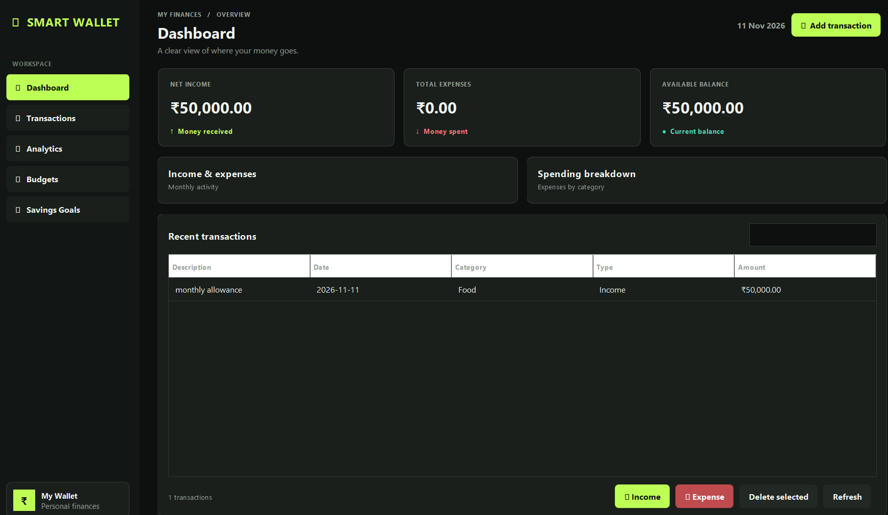
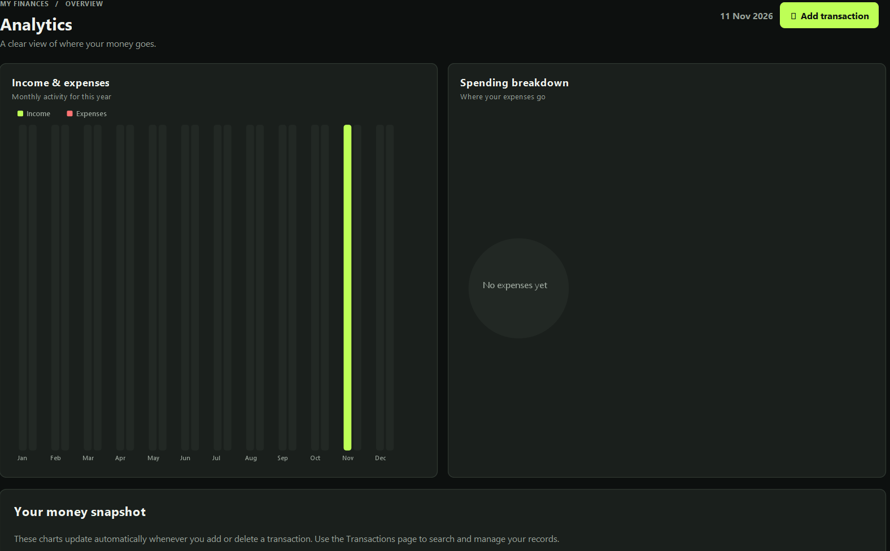
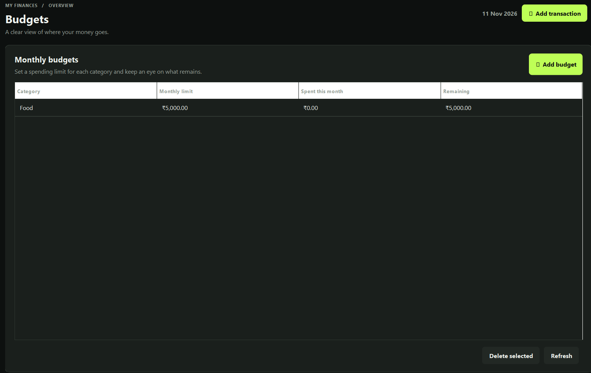
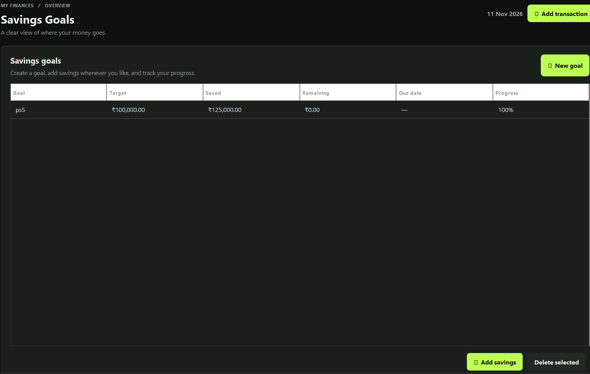

# Smart Expense Tracker

A modern, dark-themed desktop application developed using Java Swing to help users manage their personal finances. The application provides tools to track income and expenses, monitor budgets, set savings goals, and analyse spending patterns.

## Features

- **Dashboard:** View total income, expenses, and available balance.
- **Transaction Management:** Add, search, and delete income and expense transactions.
- **Analytics:** Visualise income, expenses, and category-wise spending.
- **Budget Management:** Set monthly category budgets and monitor spending limits.
- **Savings Goals:** Create savings targets and track progress.
- **CSV Export:** Export transaction records for external use.
- **SQLite Database:** Store financial records locally.
- **Modern GUI:** Dark-themed interface with rounded buttons and user-friendly forms.

## Technologies Used

- Java 17
- Java Swing
- SQLite
- JDBC
- Maven
- IntelliJ IDEA

## Requirements

- JDK 17 or newer
- IntelliJ IDEA or another Java IDE
- Maven support

## How to Run

1. Download or clone this repository.
2. Open the project in IntelliJ IDEA.
3. Select the folder containing `pom.xml`.
4. Allow IntelliJ IDEA to import the Maven dependencies.
5. Locate `Main.java` inside the source directory.
6. Run the `Main` class.

The SQLite database is created locally when the application runs.

## Project Screenshots

### Dashboard

### Add Transaction

### Analytics

### Budget Management

### Savings Goals

## Project Team

| Name | Roll Number |
|---|---|
| Pondrati Charan Kousik | AP25110010405 |
| Bongu Sai Cheran | AP25110010999 |
| Devarapu Chiruhas | AP25110010517 |
| Revu Sujan Chakravarthy | AP25110010221 |

**Project Guide:** Srikanth Lukka

## Institution

**SRM University–AP**  
Department of Computer Science and Engineering

---

Developed as an academic project.
